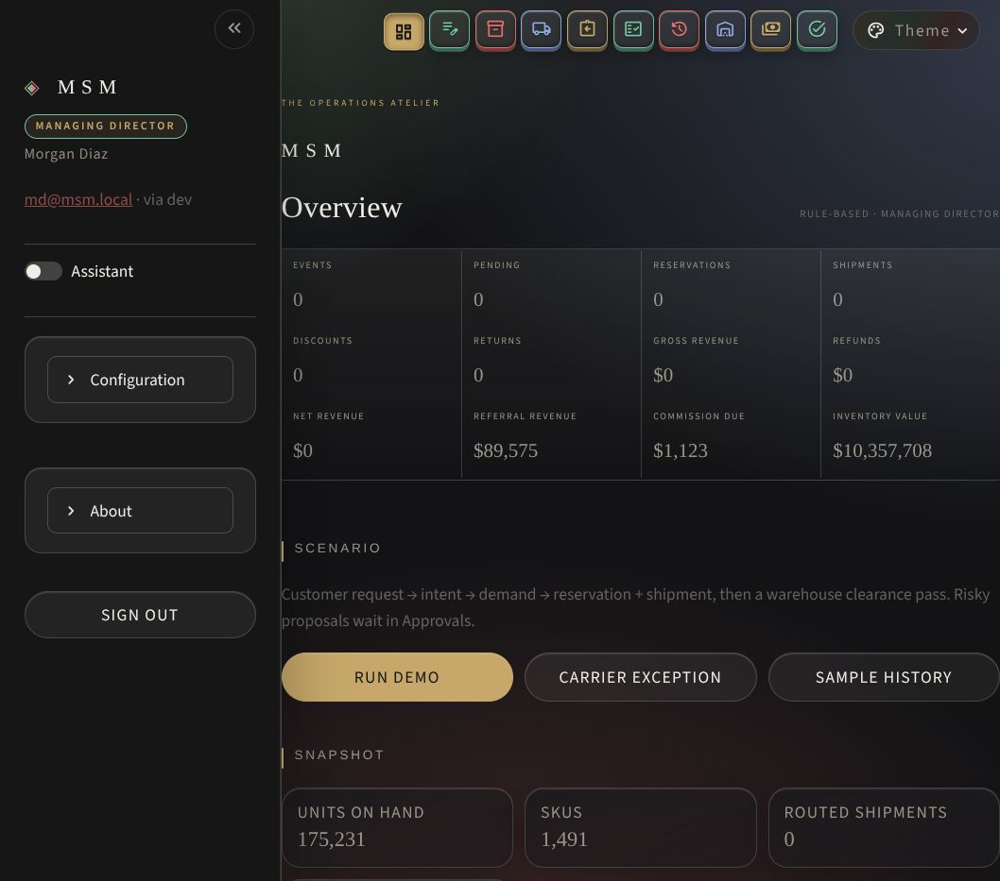
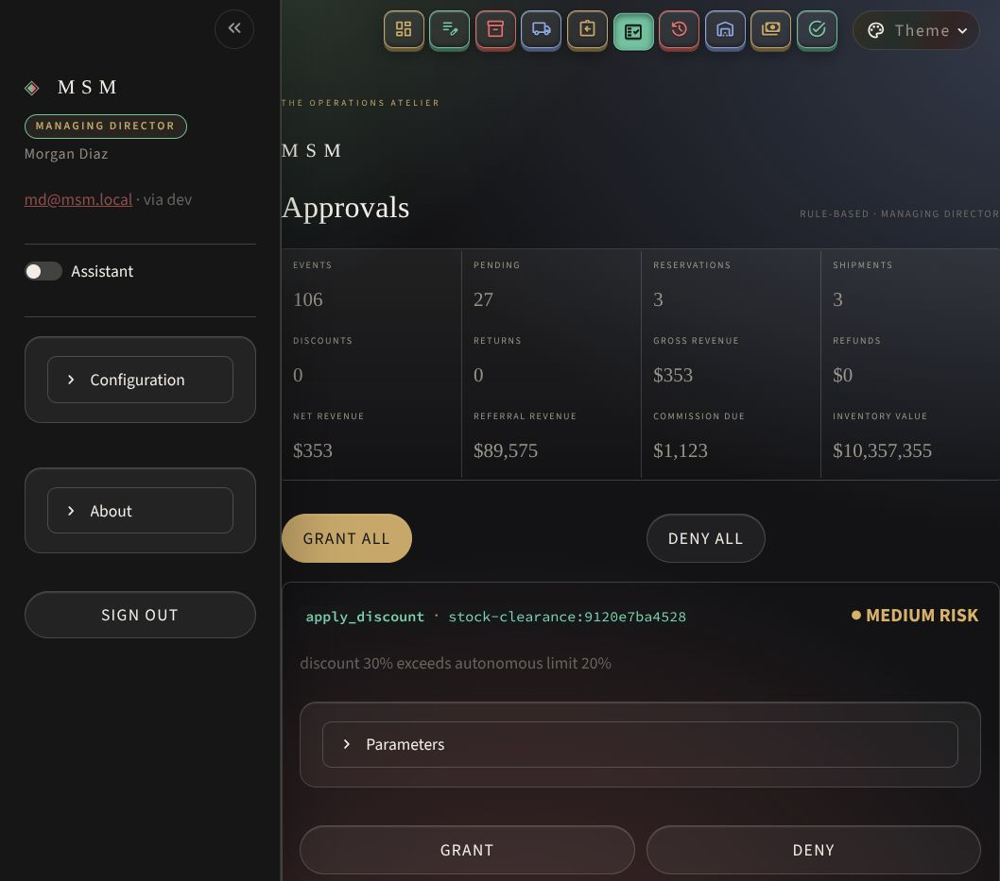
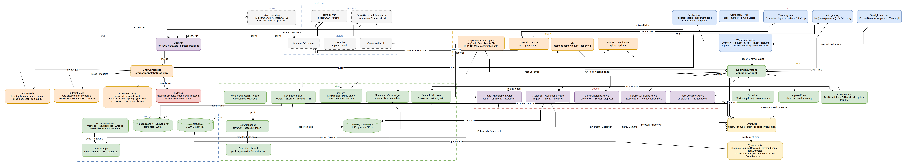
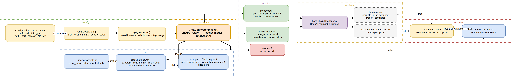

# EXIM Framework — MSM Operations Console

<div align="center">



**Event-driven commerce operations, executed with precision.**

[](https://www.python.org/)
[](https://streamlit.io/)
[](#testing)
[](#license)

</div>

## Table of contents

- [What this is](#what-this-is)
- [Feature highlights](#feature-highlights)
- [Quick start](#quick-start)
- [Application tour](#application-tour)
- [Architecture](#architecture)
- [Repository layout](#repository-layout)
- [Data and storage model](#data-and-storage-model)
- [AI / ML integration](#ai--ml-integration)
- [Tasks from mail and forms](#tasks-from-mail-and-forms)
- [Theme system](#theme-system)
- [Document intake](#document-intake)
- [Posters and promotions](#posters-and-promotions)
- [CLI and HTTP API](#cli-and-http-api)
- [Deployment](#deployment)
- [Documentation](#documentation)
- [Configuration reference](#configuration-reference)
- [Testing](#testing)
- [Security notes](#security-notes)
- [Troubleshooting](#troubleshooting)
- [Contributing](#contributing)
- [License](#license)

---

## What this is

MSM is a medium-scale operations framework for e-commerce: customer requirements,
stock clearance, transit management, returns/refunds, finance read models, a role-based
console, and a deterministic rule engine with optional local AI models.

Everything is coordinated through a typed in-process event bus. Agents never call
each other directly; side effects pass through an approval gate. The console, CLI and
optional FastAPI service all share the same `EcomopsSystem` composition root.

- **No external database required** — the event bus and an optional JSONL journal are the source of truth.
- **Offline by default** — deterministic rules handle every LLM task; AI is opt-in.
- **Multi-role** — MD, Supervisor, Staff and Accountant see different workspaces and actions.
- **Runnable anywhere** — local Streamlit server, Docker container, or FastAPI service.
- **Extensible** — add an event, a rule, an agent, or a theme without touching the domain core.

---

## Feature highlights

| Area | Capability |
|---|---|
| **Operations** | Customer request → intent → demand → clearance → shipment → exception → return flows |
| **Dashboards** | Ten permission-driven workspaces, compact KPI rail, event trace and charts |
| **Tasks** | Extract actionable items from IMAP mail and customer forms into a per-user task board |
| **Documents** | Upload PDF/PNG/JPEG; classify, extract fields, resolve, fill and download |
| **Creatives** | Clearance posters and transit notices rendered with Pillow; web image search |
| **Themes** | Six four-hue palettes: 3 frosted-glass and 3 flat; Soft/Crisp contrast |
| **Assistant** | Role-aware Q&A with deterministic fallback and optional local LLM |
| **AI connector** | Off / OpenAI-compatible endpoint / GGUF via llama-server, with number grounding |
| **Integration** | CLI, FastAPI control plane, JSONL journal, Prometheus metrics |
| **Deployment** | Dockerfile, Compose, local git repo and a LangChain Deep Agents deploy agent |

---

## Quick start

### 1. Local console (recommended)

The repository ships a ready-to-run `.venv` with rewritten paths.

```bash
cd msm
.venv/bin/python -m streamlit run src/ecomops/app.py \
  --server.port 8501 --server.headless true --server.address 127.0.0.1
```

Open <http://localhost:8501>.

**Demo accounts** (password `msm`):

| Account | Role | Access |
|---|---|---|
| `md@msm.local` | Managing Director | Everything |
| `supervisor@msm.local` | Supervisor | Operations, approvals, audit |
| `staff@msm.local` | Staff | Day-to-day actions |
| `accountant@msm.local` | Accountant | Finance and refunds only |

### 2. Recreate the environment

```bash
cd msm
uv venv --python 3.14 .venv
uv pip install --python .venv/bin/python -e ".[dev,ui,api,chat,docs]"
```

### 3. Verify

```bash
.venv/bin/ruff check src tests deploy_agent
.venv/bin/python -m pytest -q
curl http://localhost:8501/_stcore/health   # -> ok
```

---

## Application tour



The top-right icon rail is the primary navigation. Hover an icon to see its name; the
active icon is filled with the current theme accent. The Theme pill sits beside it.
The sidebar holds the Assistant, Configuration, About and Sign out.

| Workspace | What it does |
|---|---|
| **Overview** | KPI rail, Run Demo, Carrier Exception, Sample History, snapshot and event charts |
| **Customer request** | Submit free-text requests, inspect captured intent and clarifications |
| **Stock clearance** | Analyse overstock, review discount strategies, generate clearance posters |
| **Transit** | Shipments, carrier exceptions, customer shipping notices |
| **Returns** | Damaged-item flow, refund/replacement assessments |
| **Approvals** | Risk-scoped proposal queue; grant/deny individually or in bulk |
| **Event trace** | Filter/search the event trail with correlation and causation ids |
| **Inventory** | Search/filter catalogue; optionally merge the 1,481-product grocery CSV |
| **Referrals & finance** | Revenue, refunds, markdown value and a deterministic referral ledger |
| **Tasks** | Email/form-derived task board with status transitions and per-user scoping |

A full walkthrough with screenshots is in [`docs/user-guide/MSM_User_Guide.pdf`](docs/user-guide/MSM_User_Guide.pdf).

---

## Architecture



```text
UI (Streamlit) ─┐
CLI ────────────┼──> EcomopsSystem ──> EventBus ──> 5 Agents
API (FastAPI) ──┘        │                │             │
                         ├─ ApprovalGate   ├─ Journal    ├─ Inventory
                         ├─ LLM/Rules      └─ Metrics    ├─ Finance
                         └─ Embedder                     └─ Documents/Renderers
```

Key design rules:

1. **Typed events only** — `Event` subclasses carry domain facts with shared envelope metadata.
2. **Bus as store** — history is the source of truth; `bus.drain()` runs subscribers deterministically.
3. **Approval gate** — every side effect starts as `ActionProposed` and waits for a human decision.
4. **Deterministic fallback** — every LLM task has a rule handler; the app never depends on a model.
5. **Theme skin only** — `theme.py` swaps CSS variables; domain logic and posters keep their own colours.
6. **Pure read models** — metrics, finance and task state are folded from events, never mutated in place.

Editable diagrams: [`docs/architecture/*.drawio`](docs/architecture/).
Developer details: [`docs/developer-doc/MSM_Developer_Document.pdf`](docs/developer-doc/MSM_Developer_Document.pdf).

---

## Repository layout

```text
msm/
├── src/ecomops/
│   ├── app.py              Streamlit console, navigation, workspaces
│   ├── theme.py            Six palettes, glass/flat CSS variables
│   ├── system.py           Composition root and entry points
│   ├── events.py / bus.py  Typed events, correlation/causation, history
│   ├── policy.py           Approval gate and policy thresholds
│   ├── llm.py / rules.py   LLM protocol, rule fallback, embedder
│   ├── agents/             Customer, clearance, transit, returns, tasks
│   ├── inventory.py        Catalogue, stock, matching
│   ├── finance.py          Revenue/refund/referral read models
│   ├── metrics.py          Event counters and Prometheus text
│   ├── mail.py             IMAP reader and MIME parsing
│   ├── tasks.py            Task fold and status transitions
│   ├── chat.py / chatmodel.py  Assistant and model connector
│   ├── documents/          Extract, classify, resolve, fill
│   ├── advert.py           Poster and notice rendering
│   ├── webimages.py        Web image search and cache
│   ├── promotion.py        Dispatch channels and reports
│   └── api.py / cli.py     HTTP control plane and CLI
├── deploy_agent/           LangChain Deep Agents deployment automation
├── data/                   Grocery catalogue and image cache
├── docs/                   Architecture diagrams, user guide, developer doc
├── tests/                  293 offline, deterministic tests
├── Dockerfile / docker-compose.yml / .dockerignore
├── AGENTS.md               Agent operating rules for this repo
├── PROJECT_WRITEUP.md      Executive project write-up
└── README.md               This document
```

---

## Data and storage model

There is **no relational database**. The system uses:

| Store | Technology | Contents |
|---|---|---|
| Event bus | In-memory list | Typed events with correlation/causation |
| Journal | JSONL file | Durable append-only audit trail |
| Session state | Streamlit server-side | User, active view, theme, chat history, document/IMAP/chat config |
| Inventory | In-memory dict | Built-in SKUs plus optional grocery CSV |
| Catalogue | CSV | 1,481 grocery products |
| Image cache | Disk | Downloaded web images |
| Document workdirs | `tempfile.mkdtemp()` | Uploaded and filled files (0700) |
| Task state | Derived | Fold of `TaskExtracted` + `TaskStatusChanged` |

Core schemas are Pydantic v2 models. `Event` enforces `extra="forbid"`; `event_classes()`
auto-registers new event types for the journal and API. See the developer document for
every field.

---

## AI / ML integration

### Deterministic first

`rules.py` registers eight tasks used by agents and UI:

```text
capture_intent          extract_tasks
develop_clearance_strategy   plan_route
resolve_exception       assess_return
write_advert_copy       write_transit_copy
```

`RuleBasedLLM` always works offline. `FallbackLLM` tries an optional MLX model
(`mlx-community/Qwen3-4B-4bit`) and falls back to rules on any failure. Embeddings use
`all-MiniLM-L6-v2` when `sentence-transformers` is installed, otherwise token overlap.

### Chat connector



`src/ecomops/chatmodel.py` supports three modes:

| Mode | Behaviour |
|---|---|
| `off` | No model call; deterministic answers only |
| `endpoint` | Any OpenAI-compatible server; model id auto-discovered from `/models` |
| `gguf` | Starts `llama-server` for a `.gguf` path, stops only its own process |

The assistant builds a compact JSON snapshot, sends it with the question, and rejects
answers containing numbers absent from the snapshot — preventing invented figures.

Configure in **Configuration → Chat model** or with environment variables. Press
**Test chat model** to verify the endpoint before use.

---

## Tasks from mail and forms

The **Tasks** workspace is a per-user dashboard. Tasks come from:

1. **IMAP inbox** — configure host, port, user and password/app token in the sidebar, then press **Read inbox** in Tasks. TLS is default; scanning is read-only unless **Mark as read** is enabled.
2. **Customer form** — *Create tasks from a customer form* feeds free text through the same extractor without an inbox.

Both sources publish `EmailReceived` or `FormReceived`. The `TaskExtractionAgent` uses the
deterministic `extract_tasks` rule (or optional model) and emits `TaskExtracted` events.
Status changes append `TaskStatusChanged`; the dashboard folds current state. Managers
can enable **All assignees**.

---

## Theme system

`theme.py` defines six palettes, each with four distinct hues:

| Material | Themes |
|---|---|
| **Glass** | Obsidian Gold (default), Midnight Sapphire, Emerald Ledger |
| **Flat** | Terracotta Atelier, Rose Quartz, Graphite & Silver |

Each theme exposes surface, text, accent and glass tokens as CSS variables injected after
the base stylesheet. Soft and Crisp contrast levels are available in the picker. Switching
themes never rebuilds widgets; posters and domain output keep their own branded palettes.

---

## Document intake

Attach a PDF, PNG or JPEG in the assistant composer:

1. Validate type, size (10 MB) and page count (10).
2. Extract text and word boxes (`pdftohtml` / `pdftoppm` + optional Tesseract OCR).
3. Classify as purchase order, return slip, stock sheet or generic form.
4. Extract fields from regex specs and resolve them against inventory and bus events.
5. Ask the operator only for blocking gaps.
6. Fill the original layout or produce a reflowed PDF, then offer download.

The audit trail records `DocumentUploaded → DocumentFieldsResolved → DocumentFilled`
with metadata only — never document bytes.

---

## Posters and promotions

- **Clearance poster**: choose from applied discounts, proposals or stock; set company, old/new prices, up to five photos (upload or web), tone and format.
- **Transit notice**: pick a routed shipment, confirm details, render a poster and send it to that customer through a chosen channel.
- Rendering is Pillow-based with fixed branded colours, independent of the console theme.
- Dispatch results are published as `PromotionPublished` / `TransitNoticeSent` events.

---

## CLI and HTTP API

```bash
# CLI
.venv/bin/ecomops demo --approve yes
.venv/bin/ecomops request "3 mechanical keyboards to Berlin ASAP"
.venv/bin/ecomops exceptions
.venv/bin/ecomops stock
.venv/bin/ecomops returns
.venv/bin/ecomops catalogue --grocery data/grocery_catalogue.csv --search "peanut butter"
.venv/bin/ecomops replay events.jsonl --verify
.venv/bin/ecomops ui

# API
.venv/bin/ecomops serve --port 8000
curl http://localhost:8000/docs
```

The API uses `SessionCodec` bearer tokens, role guards, and endpoints for requests,
stock, exceptions, returns, approvals, documents, events, finance and metrics. Every
command accepts `--journal PATH` for durable event replay.

---

## Deployment

### Docker

```bash
docker compose up -d --build
curl http://localhost:8501/_stcore/health
```

The image uses Python 3.14 slim, installs poppler for document intake, and serves the
console on port 8501 with a healthcheck.

### Deep Agents deployment agent

```bash
export ECOMOPS_DEEPAGENTS_BASE_URL=http://127.0.0.1:38285/v1
export ECOMOPS_DEEPAGENTS_MODEL=MiMo-V2.6-Distill-Qwen-9B-Q8_0
export ECOMOPS_DEEPAGENTS_API_KEY=<local-llama-server-key>

.venv/bin/python -m deploy_agent.cli "check repo status and run the tests"
.venv/bin/python -m deploy_agent.cli "build the Docker image DEPLOY-MSM"
```

The agent uses the LangChain Deep Agents SDK with the local GGUF runtime. Read-only
tools are free; mutating tools require the exact phrase `DEPLOY-MSM` in the request.
No tool pushes to a remote. See [`deploy_agent/README.md`](deploy_agent/README.md).

---

## Documentation

| Document | Contents |
|---|---|
| [Project write-up](PROJECT_WRITEUP.md) / [PDF](docs/writeup/MSM_Project_Writeup.pdf) | Executive summary, problem, solution, decisions, verification and future work |
| [User guide](docs/user-guide/MSM_User_Guide.pdf) | 21 pages, all features, workflows and screenshots |
| [Developer document](docs/developer-doc/MSM_Developer_Document.pdf) | 16 pages: architecture, schemas, storage, UI/UX, AI, flows, security |
| [Architecture diagrams](docs/architecture/) | Editable `.drawio` sources and PNG exports |
| [Document intake plan](docs/document-intake-plan.md) | Intake pipeline design and limits |
| [This README](README.md) | Setup and navigation |

---

## Configuration reference

| Variable | Default | Purpose |
|---|---|---|
| `ECOMOPS_SSO_MODE` | `dev` | `dev`, `oidc` or `proxy` authentication |
| `ECOMOPS_DEMO_PASSWORD` | `msm` | Demo credential |
| `ECOMOPS_SESSION_SECRET` | dev placeholder | HMAC key for API bearer tokens |
| `ECOMOPS_AUTH_AUTOLOGIN` | unset | Test-only role bypass |
| `ECOMOPS_GROCERY` | auto | CSV path or `none` to disable |
| `ECOMOPS_MAIL_HOST` | unset | IMAP host |
| `ECOMOPS_MAIL_PORT` | `993` | IMAP port |
| `ECOMOPS_MAIL_USER` / `ECOMOPS_MAIL_PASSWORD` | unset | IMAP credentials |
| `ECOMOPS_MAIL_FOLDER` / `LIMIT` / `SSL` / `MARK_SEEN` | `INBOX` / `20` / `true` / `false` | Inbox behaviour |
| `ECOMOPS_CHAT_MODE` | `endpoint` | `off`, `endpoint` or `gguf` |
| `ECOMOPS_CHAT_BASE_URL` | Lemonade `13305` | Chat endpoint |
| `ECOMOPS_CHAT_MODEL` | `Llama-3.2-1B-Instruct-GGUF` | Model id |
| `ECOMOPS_CHAT_GGUF` | unset | GGUF file path |
| `ECOMOPS_CHAT_PORT` / `CTX` / `NGL` | `38285` / `8192` / `-1` | llama-server settings |
| `ECOMOPS_DEEPAGENTS_*` | local llama-server | Deployment agent model/key |
| `ECOMOPS_WEB_IMAGES` | `on` | Enable web image search |

---

## Testing

```bash
.venv/bin/ruff check src tests deploy_agent
.venv/bin/python -m pytest -q
```

- **293 tests**, fully offline and deterministic.
- Coverage includes UI flows, role gates, themes, event bus, rules, agents, documents,
  posters, notices, mail, task extraction, chat connector and deployment tools.

---

## Security notes

- The demo mode prints the password `msm` and grants full MD access. **Do not expose it
  to the internet**; bind to `127.0.0.1` or configure OIDC/proxy with TLS.
- Set `ECOMOPS_SESSION_SECRET` to a long random value before exposing the API.
- IMAP and chat secrets stay in the browser session or environment and are hidden in reprs.
- All user-derived HTML is escaped before `unsafe_allow_html` rendering.
- Uploads are size/page limited, filenames are sanitized, and temp dirs are `0700`.
- The deployment agent requires `DEPLOY-MSM` for mutations and never pushes to a remote.

---

## Troubleshooting

| Symptom | Check |
|---|---|
| Assistant answers from rules only | Chat mode/endpoint, `Test chat model` button |
| Tasks list empty | Configure IMAP or use the customer form in Tasks |
| PDF upload fails | Install poppler; check 10 MB / 10 page limits |
| Theme looks flat/glass unexpectedly | Theme picker badge and contrast setting |
| API rejects bearer tokens | `ECOMOPS_SESSION_SECRET` must match between issuer and verifier |
| Docker build fails | Ensure Docker is installed and port 8501 is free |

---

## Contributing

1. Inspect first: `repo_status`, `list_files`, `read_file` (or plain git/grep).
2. Keep changes small; add a test for new behaviour.
3. Run `ruff` and `pytest` before committing.
4. Add or update docs under `docs/` and regenerate PDFs with the build scripts.
5. Never commit secrets; `.env` is ignored.

See [`AGENTS.md`](AGENTS.md) for the deployment agent operating rules.

---

## License

MIT. See `LICENSE` if present; otherwise the project is provided as-is for demonstration
and extension.
